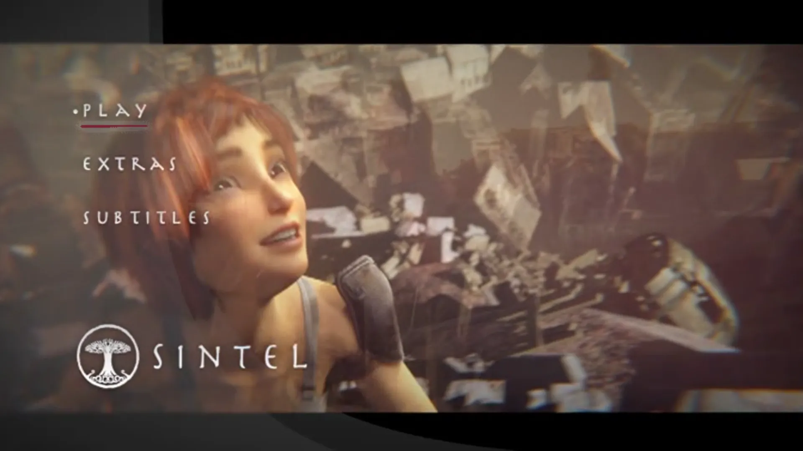
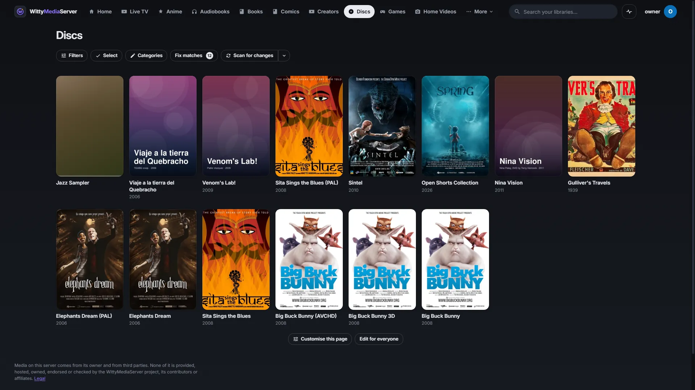

# WittyDisc

Reads DVD and Blu-ray disc images without mounting them, and plays them in [WittyMediaServer](https://github.com/wittywilla/WittyMediaServer)'s web app. You don't open it yourself: WittyDVD and WittyBluray are built on it. Its web part (`web/`, built with WittyModule's `kit/web`) is the disc player they share in a browser, with Settings' DVDs and Blu-rays; developers can use the rest as a Go library. WittyMediaServer's site is https://wittymediaserver.com.

<!-- pictures -->



<sub>WittyDVD showing a menu that WittyDisc read from the image. [Sintel](https://durian.blender.org/), Blender Foundation, [CC BY 3.0](https://creativecommons.org/licenses/by/3.0/).</sub>



<sub>Disc images on a shelf in WittyMediaServer. From a test server. The server's [credits list](https://github.com/wittywilla/WittyMediaServer/blob/master/docs/images/CREDITS.md) names everything shown.</sub>

<!-- /pictures -->

## What it does

| Format | Used by | Details |
|---|---|---|
| UDF 1.02 | DVD-Video | The file system DVD players read |
| UDF 2.50 | Blu-ray | Metadata partitions, extended file entries, chained allocation descriptors for large files, and the mirror copy of the metadata when the main one can't be read |
| UDF 1.50 to 2.60 | Burned and rewritable discs | Sparable partitions (through the sparing table), virtual partitions (through the allocation table at the end of the disc), extended allocation descriptors, and parts of files the disc doesn't record, which read as zeros |
| ISO 9660 | DVD bridge discs | A fallback, including multi-extent files over 4 GiB |

- **Files as byte ranges:** each file's size and the ranges it occupies, so a very large stream is read in place, or handed to FFmpeg, and never copied. A range marked `Zero` (offset -1) is part of a file the disc doesn't record, and reads as zeros.
- **Safe with damaged images:** sizes and depths are bounded, descriptor chains are limited, and nothing is trusted to be where it claims.
- It decrypts nothing, and no media comes with it.

The `session` package is the contract between a player and a disc engine's module: what to show, which bytes to decode and where the buttons are.

## How it fits

WittyDisc is a module of WittyMediaServer, in two halves. The web part is a module of its own in the store (a `web` module, built for module API 5), and a core one: [WittyDVD](https://github.com/wittywilla/WittyDVD) and [WittyBluray](https://github.com/wittywilla/WittyBluray) name it in `requires`, so a server adds it before either of them, and as a core module it can't be taken off a server. The Go library reaches a server inside those two modules. The disc sessions the player opens, the streams and the refusal of encrypted discs stay with the server.

## How to get it

There's nothing to add by hand. Add WittyDVD or WittyBluray from the module store inside WittyMediaServer, **Settings → Modules → Browse the store → Add**, and WittyDisc comes first.

This version is for module API 5, on WittyMediaServer 0.8.0-alpha through 0.8.x (`minServer` and `maxServer` in [module.json](module.json)). A server takes module API 5 only, so nothing older works.

For a Go program:

```bash
go get github.com/wittywilla/wittydisc
```

## What it needs

Go 1.26 or newer. The Go library uses no cgo and nothing beyond Go's standard library. The web part needs Node.js and npm, and a checkout of [WittyModule](https://github.com/wittywilla/WittyModule) for its `kit/web` builder.

## Platforms

It's plain Go, and CI builds it for Windows, macOS, Linux and FreeBSD. Its tests have been run on Linux. It has not been run on a real Mac, or on FreeBSD, where it has only been cross-compiled.

## Building and testing

What CI runs, the Go half:

```bash
go run github.com/wittywilla/wittymodule/cmd/wittymodule@v0.5.4 check .
go vet ./...
go test ./... -count=1
```

The web part, with a WittyModule checkout at `../WittyModule` (or `WITTYMODULE` set to one):

```bash
npm ci
npm test
npm run build:bundle
```

| Call in `isofs` | Does |
|---|---|
| `Open(path)` | Opens an image: UDF first, then ISO 9660 |
| `Files()`, `Find(path)` | Every file, or one by path, ignoring case |
| `ReadFile(path, max)` | A whole file, with a size cap |
| `Reader(file)` | An `io.ReaderAt` over a file's ranges |

## Licence

GNU Affero General Public License v3.0 (or later): see [LICENSE](LICENSE) and [NOTICE](NOTICE). If you redistribute it or build on it, please keep the NOTICE attribution.

<!-- module-kit -->
## Releasing

A version tag builds the bundle for the browser, signs the checksum list, and publishes a release that servers can install.

Versions move in small steps as work lands. `go run github.com/wittywilla/wittymodule/cmd/wittymodule@v0.5.4 bump .` raises it
everywhere it is written (add `-part minor` for a bigger step). A bump isn't a release: nothing is
tagged or published until you tag it. CI fails when code changed since the last tag and the version
didn't, because tags never move.

To release:

1. Check that `version` in `module.json` is the one to publish, with the bump committed.
2. Tag that commit and push the tag: `git tag vX.Y.Z`, then `git push origin vX.Y.Z`. A tag with a
   suffix, such as `v1.2.0-beta`, is published as a prerelease.
3. Watch the *Actions* tab. The signing step uses the `WMS_SIGNING_KEY` secret of the `release` environment, and nothing is published without it.

To take a version back, run the *withdraw* workflow from the *Actions* tab. It adds the version to a signed list on the release tagged `withdrawals`, which servers read.

Licensed under AGPL-3.0-or-later: see [LICENSE](LICENSE) and [NOTICE](NOTICE).
<!-- /module-kit -->

## Legal

WittyDisc is an independent open-source project. It isn't associated with, sponsored by or endorsed
by the owners of the DVD or Blu-ray formats, any film studio or any other player project. It reads
disc images you already have. It doesn't decrypt anything and no media comes with it: you're
responsible for having the rights to what you open. Any third-party names here only describe what it
works with, and belong to their owners. It's provided “as is”, with no warranty; see
[LICENSE](LICENSE). Local law applies to how you use it. This isn't legal advice.
