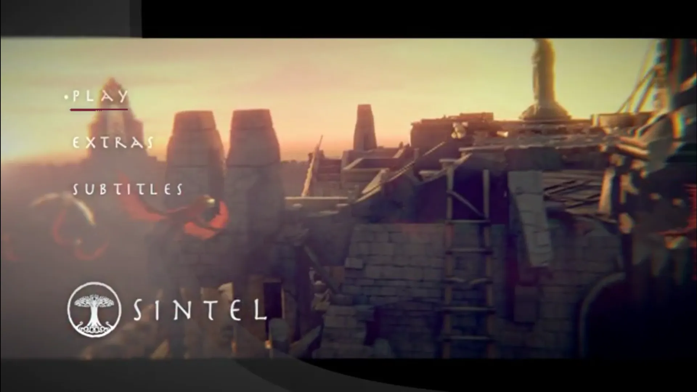
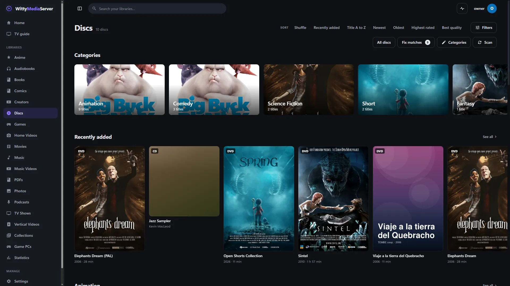

# WittyDisc

Reads DVD and Blu-ray disc images without mounting them. You don't install or open it yourself: WittyDVD and WittyBluray are built on it, and developers can use it as a Go library.

<!-- pictures -->



<sub>WittyDVD showing a menu that WittyDisc read from the image. [Sintel](https://durian.blender.org/), Blender Foundation, [CC BY 3.0](https://creativecommons.org/licenses/by/3.0/).</sub>



<sub>Disc images on a shelf in WittyMediaServer. From a test server. The server's [credits list](https://github.com/wittywilla/WittyMediaServer/blob/master/docs/images/CREDITS.md) names everything shown.</sub>

<!-- /pictures -->

## What it does

| Format | Used by | Details |
|---|---|---|
| UDF 1.02 | DVD-Video | The file system DVD players read |
| UDF 2.50 | Blu-ray | Metadata partitions, extended file entries, chained allocation descriptors for large files, and the mirror copy of the metadata when the main one can't be read |
| UDF 1.50 to 2.60 | Burned and rewritable discs | Sparable partitions (through the sparing table), virtual partitions (through the allocation table at the end of the disc), extended allocation descriptors, and parts of files the disc doesn't record, which read as zeros |
| ISO 9660 | DVD bridge discs | A fallback, including multi-extent files over 4 GiB |

- **Files as byte ranges:** each file's size and the ranges it occupies, so a very large stream is read in place, or handed to FFmpeg, and never copied. A range marked `Zero` (offset -1) is part of a file the disc doesn't record, and reads as zeros.
- **Safe with damaged images:** sizes and depths are bounded, descriptor chains are limited, and nothing is trusted to be where it claims.
- It decrypts nothing, and no media comes with it.

The `session` package is the contract between a player and a disc engine's module: what to show, which bytes to decode and where the buttons are.

## How to get it

There's nothing to add. It reaches a server inside [WittyDVD](https://github.com/wittywilla/WittyDVD) and [WittyBluray](https://github.com/wittywilla/WittyBluray), which you add from the module store inside WittyMediaServer: **Settings → Modules**. That needs WittyMediaServer 0.6.0-alpha or later, and nothing older works.

For a Go program:

```bash
go get github.com/wittywilla/wittydisc
```

## What it needs

Go 1.26 or newer. It uses no cgo and nothing beyond Go's standard library.

## Platforms

It's plain Go, and CI builds it for Windows, macOS, Linux and FreeBSD. Its tests have been run on Linux. It has not been run on a real Mac, or on FreeBSD, where it has only been cross-compiled.

## Building and testing

```bash
go vet ./...
go test ./... -count=1
```

| Call in `isofs` | Does |
|---|---|
| `Open(path)` | Opens an image: UDF first, then ISO 9660 |
| `Files()`, `Find(path)` | Every file, or one by path, ignoring case |
| `ReadFile(path, max)` | A whole file, with a size cap |
| `Reader(file)` | An `io.ReaderAt` over a file's ranges |

## Licence

GNU Affero General Public License v3.0 (or later): see [LICENSE](LICENSE) and [NOTICE](NOTICE). If you redistribute it or build on it, please keep the NOTICE attribution.

## Legal

WittyDisc is an independent open-source project. It isn't associated with, sponsored by or endorsed
by the owners of the DVD or Blu-ray formats, any film studio or any other player project. It reads
disc images you already have. It doesn't decrypt anything and no media comes with it: you're
responsible for having the rights to what you open. Any third-party names here only describe what it
works with, and belong to their owners. It's provided “as is”, with no warranty; see
[LICENSE](LICENSE). Local law applies to how you use it. This isn't legal advice.

<!-- module-kit -->
## Releasing

WittyDisc reaches a server inside the projects built with it, so a release has no files of its own: a version tag runs the tests and publishes a release that those projects can require.

Versions move in small steps as work lands. `go run github.com/wittywilla/wittymodule/cmd/wittymodule@v0.3.0 bump .` raises it
everywhere it is written (add `-part minor` for a bigger step). A bump isn't a release: nothing is
tagged or published until you tag it. CI fails when code changed since the last tag and the version
didn't, because tags never move.

To release:

1. Check that `version` in `module.json` is the one to publish, with the bump committed.
2. Tag that commit and push the tag: `git tag vX.Y.Z`, then `git push origin vX.Y.Z`. A tag with a
   suffix, such as `v1.2.0-beta`, is published as a prerelease.
3. Watch the *Actions* tab. There is nothing to sign.

Licensed under AGPL-3.0-or-later: see [LICENSE](LICENSE) and [NOTICE](NOTICE).
<!-- /module-kit -->
